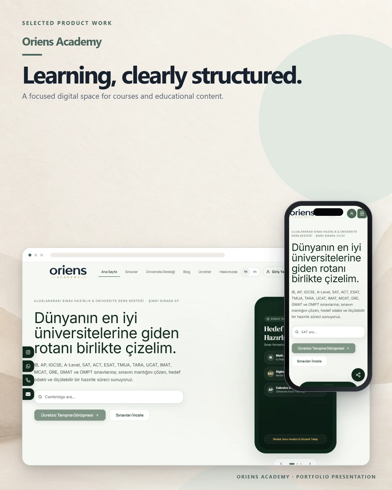

# Oriens Academy

An international exam preparation and academic consultancy platform for students planning their university path.

**Live:** [oriens-academy.com](https://oriens-academy.com) &nbsp;·&nbsp; **More work:** [github.com/mertomeroglu](https://github.com/mertomeroglu)

### Highlights

- International exam catalogue and focused preparation paths
- University support and academic consultancy content
- Turkish and English public experience
- Consultation booking and availability flow

### Built with

Next.js · React · TypeScript · Tailwind CSS · Supabase · PostgreSQL · Edge Functions

---

Presentation-only repository: this README and two presentation images built from real product screens. Application source and private configuration are not published here. Visual content and brand assets remain the property of their respective owners — see [LICENSE](LICENSE).
