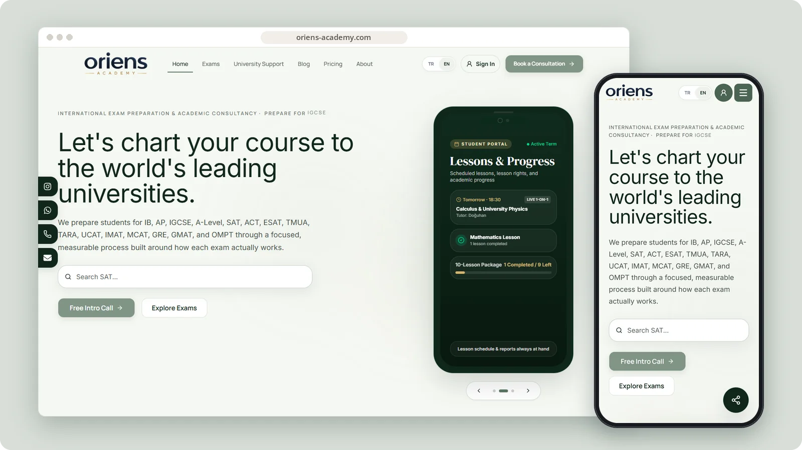
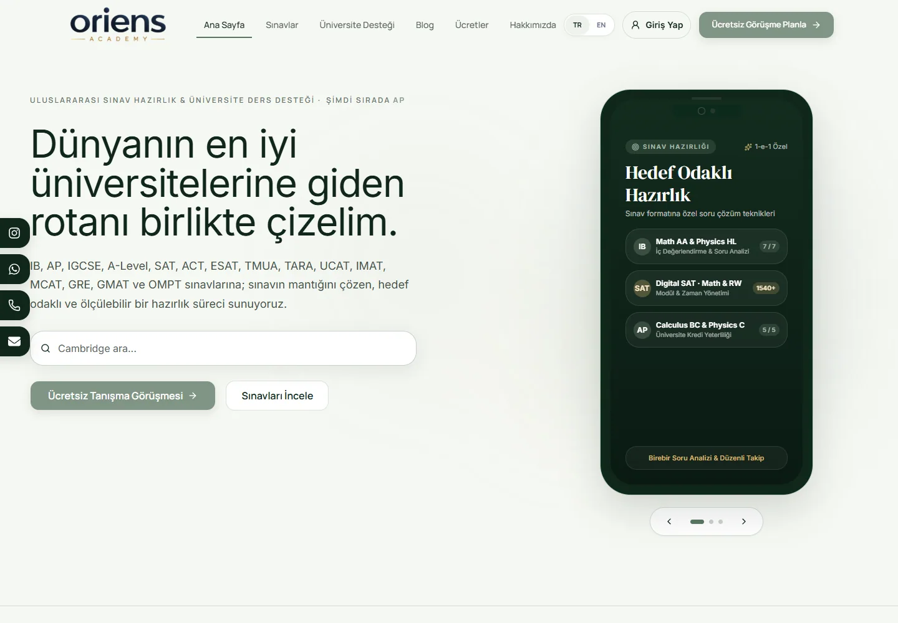
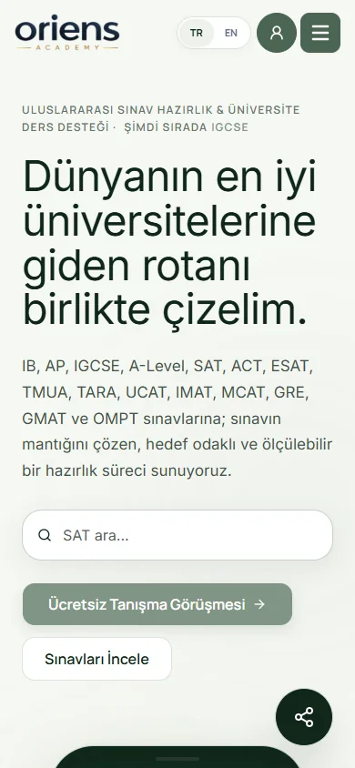

# Oriens Academy

An international exam preparation and academic consultancy platform for students planning their university path.

**[Visit oriens-academy.com ↗︎](https://oriens-academy.com)** &nbsp;·&nbsp; [More work by Mert Ömeroğlu](https://github.com/mertomeroglu)

### Highlights

- International exam catalogue and focused preparation paths
- University support and academic consultancy content
- Turkish and English public experience
- Consultation booking and availability flow

### Built with

Next.js · React · TypeScript · Tailwind CSS · Supabase · PostgreSQL · Edge Functions

### Screens

---

Presentation-only repository. Images are real, unmodified product screens in a simple frame; application source and private configuration are not published here. Brands and visual content belong to their respective owners — see [LICENSE](LICENSE).
