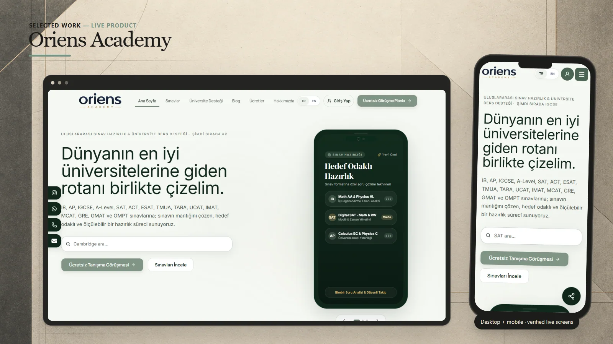

# Oriens Academy

An international exam preparation and academic consultancy platform for students planning ambitious university paths.

**[Visit live website](https://oriens-academy.com)**

## Highlights

- International exam catalogue and focused preparation paths
- University support and academic consultancy content
- Turkish and English public experience
- Consultation booking and availability flow

## Verified technology

Next.js, React, TypeScript, Tailwind CSS, Supabase, PostgreSQL, and Supabase Edge Functions are confirmed in the owner-held source repository and its architecture documentation.

## Live interface

 

## About this repository

This presentation-only repository contains selected public screenshots, this README, and a small static introduction page. Application source and private configuration are not published here.

Visual content and brand assets remain the property of their respective owners. See [LICENSE](LICENSE).
